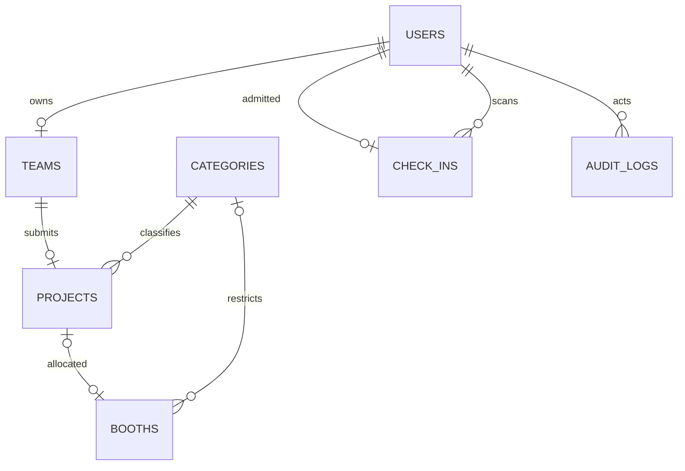
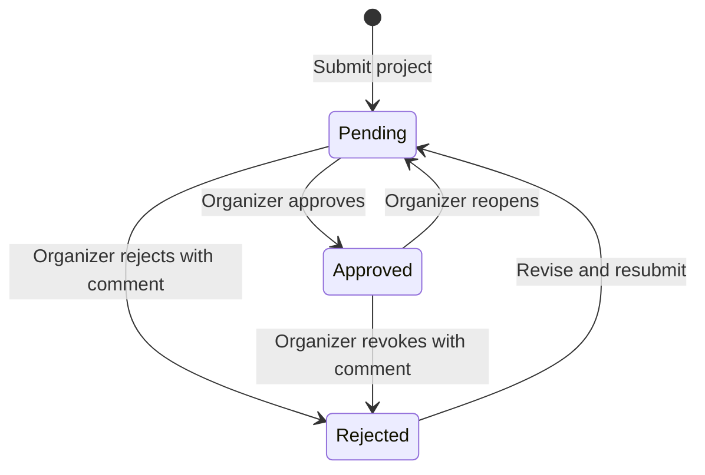
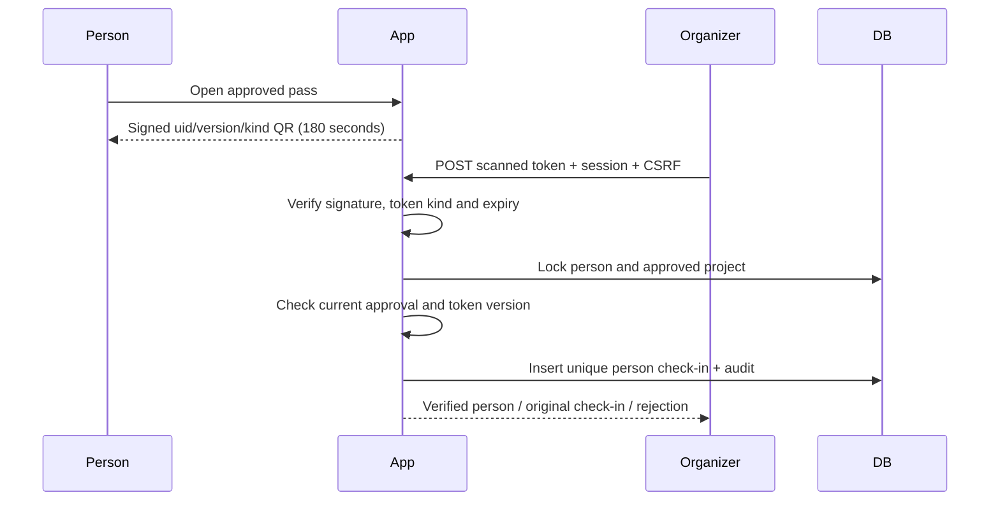

# Architecture and workflow

The application implements the single-event I-RICE system in the Chapter One proposal. Flask renders server-side Jinja templates; small JavaScript modules handle navigation, status refresh, live QR refresh and the camera scanner. Bootstrap and html5-qrcode assets are served locally, so the application does not require a browser CDN connection.

## Components

| Module | Responsibility |
| --- | --- |
| `irice/__init__.py` | Factory, configuration, CSRF, security headers, database health |
| `irice/auth.py` | Registration, login, logout, role checks |
| `irice/participant.py` | Team/profile management, submissions, image storage |
| `irice/admin.py` | Review, booth allocation, categories, reports, activity |
| `irice/passes.py` | Admission eligibility, signed QR, PDF passes, check-in |
| `irice/models.py` | SQLAlchemy relational schema |
| `irice/cli.py` | Non-destructive initialization, trusted organizer provisioning, optional demo data |

## Data relationships

Only exhibitors have a team, with one project per team. Listed team members do not automatically create accounts. A unique booth project foreign key enforces one booth per project, and the booth row holds only one project. A unique check-in user foreign key enforces one admission per registered person. Evaluators are admission accounts rather than organizers.

## Review and allocation

An approved application may await booth allocation. Participant project/team edits are locked while approved. Reopening or rejecting approval releases the booth and increments the holder's token version; resubmission resets review comments and returns to pending. Current approval is checked during every admission, independently of the token signature.

MySQL locking reads serialize person/project changes. Booth allocation locks the project and involved booth rows, checks approval/category/availability, and applies allocation in a transaction. Database constraints remain the final protection against competing requests. SQLAlchemy refreshes locked rows to avoid stale data under MySQL repeatable-read isolation.

## Admission verification

PDF admission passes use the same signed mechanism with a separate authenticated `download` kind and a 24-hour limit. A booth certificate documents allocation; it is not an admission credential. No QR GET request writes attendance. A repeated scan is idempotent, including concurrent requests. Revocation retains historic attendance for auditing, so reports can show people who attended before approval was later revoked.

## Operating boundaries

All times are stored in UTC and displayed in Asia/Kuala_Lumpur. Admission and QR verification require a network connection to the application and database. The system reserves complimentary admission upon registration, subject to organizer approval; there are no payment charges. Dates/capacities beyond the initial default booths can be customized in a future event configuration feature. The development setup does not claim production deployment, physical-camera verification or publication of a cloud snapshot.
